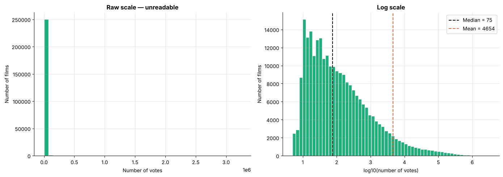
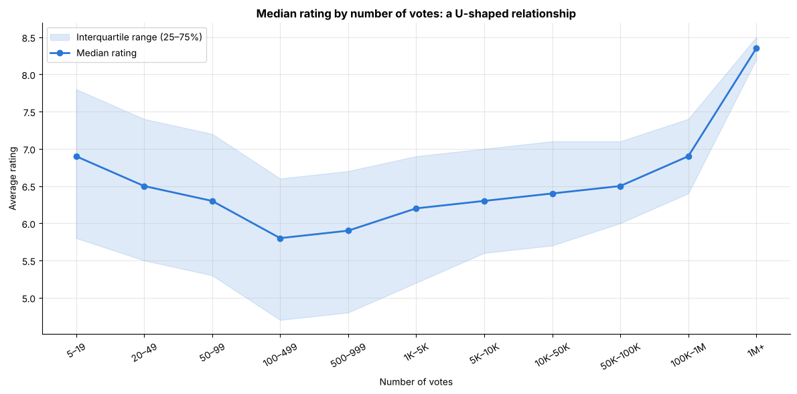
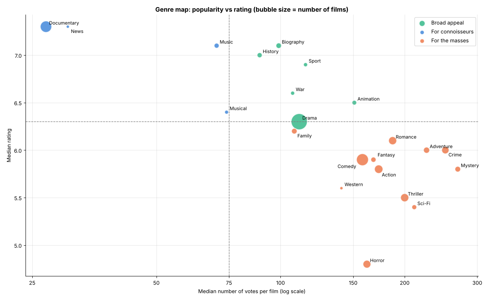
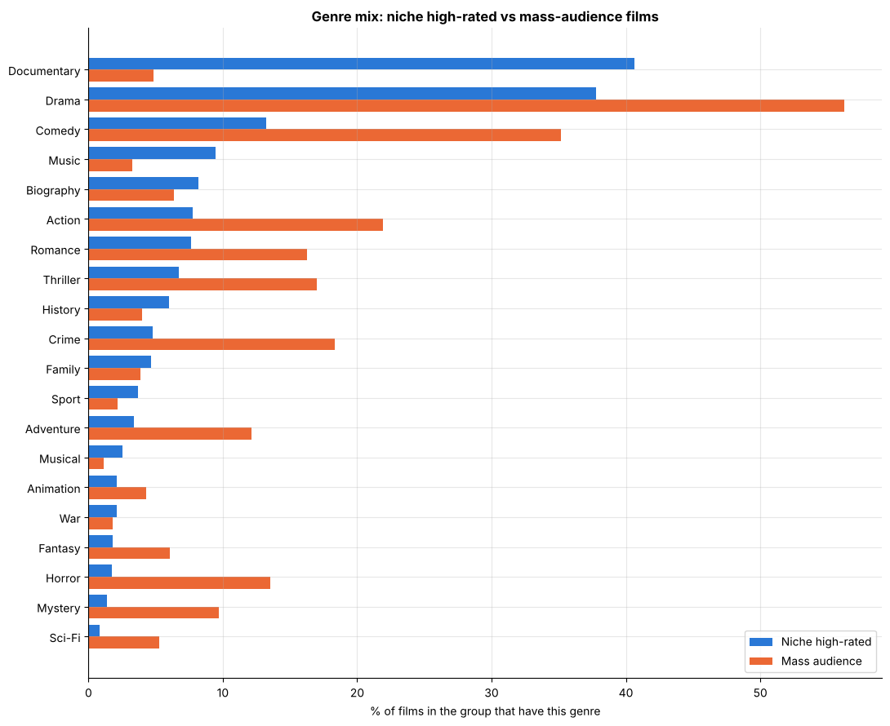

# IMDb Movie Data Analysis

**Portrait of Niche Cinema: How IMDb Ratings Relate to Popularity**

An exploratory data analysis and statistical investigation of IMDb movie ratings, audience popularity, and genre patterns using Python.

## Project at a glance

| Dataset | Period | Main tools |
|---|---|---|
| 253,584 movies after cleaning | 1980–2025 | Python · pandas · NumPy · Matplotlib · SciPy |

**Research questions:** Are highly rated films necessarily popular? Which genres attract large audiences, and which are more highly rated but less widely watched? What characterizes niche, highly rated films?

**Project type:** Collaborative university project (analysis primarily carried out by two contributors).  
**My contribution:** Data collection and cleaning, statistical analysis, and data visualization.

## Workflow and methods

1. **Collect and prepare data:** retrieve public IMDb datasets with `requests`; merge tables, filter observations, handle missing values, and validate the cleaned dataset with `pandas`.
2. **Explore distributions:** summarize ratings, votes, release years, and runtimes; use logarithmic scales for strongly skewed vote counts.
3. **Analyze relationships:** calculate Spearman rank correlations between ratings and votes, including sensitivity checks for low-vote films.
4. **Compare groups:** identify niche high-rated films and compare them with mass-audience films using chi-square tests, Mann–Whitney U tests, and a Bonferroni correction for multiple genre comparisons.
5. **Communicate results:** build charts and interpret findings, limitations, and potential implications.

## Key visualizations and findings

### 1. Why popularity needs a logarithmic scale

The number of votes is highly right-skewed: the median is **75**, while the mean is **4,654**. A logarithmic scale reveals the distribution hidden by a small number of extremely popular films.

### 2. Ratings and popularity show a U-shaped pattern

Median ratings are relatively high among films with very few votes, dip for films with roughly 100–1,000 votes, then rise for more widely rated films. Spearman's correlation is **−0.222** for all films, but **+0.161** after restricting the sample to films with at least 100 votes. This demonstrates the importance of sample selection and inspecting distributions rather than relying on a single summary statistic.

### 3. Genre positioning: popularity versus rating

Documentary, News, and Music are positioned toward higher ratings and relatively low vote counts, whereas genres such as Action, Horror, and Thriller generally receive more votes but have lower median ratings. Bubble size represents the number of films in each genre.

### 4. Genre composition of niche versus mass-audience films

Documentaries account for approximately **41% of niche high-rated films** compared with **5% of mass-audience films**. Genre-share differences were assessed using chi-square tests with Bonferroni correction.

## Definition of niche high-rated films

The project uses an operational, data-driven definition:

- At least **100 votes**, to reduce instability from very small audiences.
- No more than **2,305 votes** (the 90th percentile of votes in the dataset).
- IMDb rating of at least **8.0** (the 90th percentile of ratings).

This yields **2,507** candidate niche high-rated films. The definition identifies relatively little-known, highly rated titles within the dataset; it does not establish that every title is culturally “art-house” or objectively underrated.

## Tools

`Python` · `pandas` · `NumPy` · `Matplotlib` · `SciPy` · `requests` · `Jupyter Notebook`

**Statistical methods:** exploratory data analysis (EDA), Spearman correlation, Mann–Whitney U test, chi-square test, Bonferroni correction.

## Explore the analysis

- **[Open the full Jupyter Notebook](Niche_Cinema_IMDb.ipynb)** — code, methodology, charts, and detailed interpretations.
- **[Browse all figures](figures/)** — nine original visualizations extracted from the notebook.
- **Data source:** [IMDb non-commercial datasets](https://developer.imdb.com/non-commercial-datasets/).

**Reproducibility note:** The notebook references downloaded IMDb data and a frozen research snapshot. The original source data and intermediate files are not bundled with this repository. Some cells may require recreating the expected local directories and datasets before running end-to-end.

## Limitations

IMDb votes measure platform engagement rather than unique viewers. Ratings from films with small audiences can be unstable, and observational associations do not establish causality. Genre labels overlap because films can have multiple genres. Results depend on the dataset snapshot and filtering rules.
